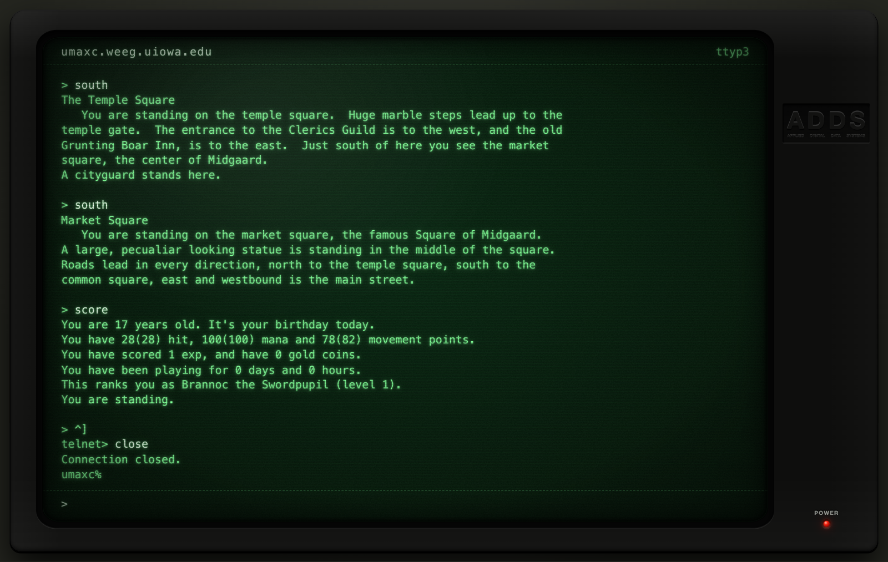

# DikuMUD in Rust



A port of **DikuMUD I (Gamma 0.0)**, the 1990–91 multi-user dungeon from
DIKU (University of Copenhagen), from C to Rust. You play it in a web browser
instead of over telnet.

The original sources are [nckroy/dikumud](https://github.com/nckroy/dikumud).
The game data in `lib/` (world, mobiles, objects, zones, shops, help, socials)
is the original data, unchanged.

> DikuMUD was created by Sebastian Hammer, Michael Seifert, Hans Henrik
> Stærfeldt, Tom Madsen and Katja Nyboe. It is **not** public domain: see
> [`doc/license.doc`](doc/license.doc). The license still applies to this port.
> In short: no profit of any kind, keep the credits, and tell the authors if you
> run it publicly.

## Running it

You need a Rust toolchain. `rust-toolchain.toml` pins one, and rustup fetches
it automatically. There are no third-party crates.

```bash
cargo run --release
```

Then open <http://127.0.0.1:4000/> in a browser. The page starts at a C shell
prompt on `umaxc.weeg.uiowa.edu`; type `telnet mud` to connect to the game.
Press `^]` (Ctrl+]) for the `telnet>` prompt, where `close` ends the session.

```
dmserver [-s] [-d <data dir>] [-b <bind address>] [port]

  -s   don't attach special procedures (shops, guilds, mob AI)
  -d   data directory (default: lib)
  -b   address to listen on (default: 127.0.0.1)
  port TCP port, above 1024 (default: 4000)
```

To let other machines on your network play, bind to all interfaces:

```bash
cargo run --release -- -b 0.0.0.0 4000
```

There is no TLS. For play over the internet, put it behind a reverse proxy
that terminates HTTPS and forwards WebSocket upgrades (Caddy or nginx). The
client switches to `wss://` automatically when it is served over HTTPS.

### Your first character

As in the original, the **first character created becomes the Implementor**
(level 24). That character skips the normal stat roll, so it starts with
Strength 0 and can't carry anything. Fix it with:

```
restore <yourname>
```

`wizhelp` lists the immortal commands. Characters you create after that are
normal level-1 players.

## What's where

Each C file became a Rust module with the same responsibilities:

| C                                    | Rust                                   |
|--------------------------------------|----------------------------------------|
| `structs.h`, `utils.h`               | `structs.rs`, `game.rs`, `utils.rs`    |
| `db.c`                               | `db.rs` (+ `save.rs` for player files) |
| `handler.c`                          | `handler.rs`                           |
| `comm.c`                             | `comm.rs` (`act()`, `send_to_*`) and `net.rs` (sockets, game loop) |
| `interpreter.c`                      | `interpreter.rs`                       |
| `act.*.c`, `changes.c`               | `act_*.rs`, `changes.rs`               |
| `fight.c`, `limits.c`, `mobact.c`    | `fight.rs`, `limits.rs`, `mobact.rs`   |
| `spell_parser.c`, `magic.c`, `spells1.c`, `spells2.c`, `spells.h` | `spell_parser.rs`, `magic.rs`, `spells.rs` |
| `shop.c`, `reception.c`, `board.c`, `modify.c`, `weather.c` | same names, `.rs`       |
| `spec_procs.c`, `spec_assign.c`, `mar_fiz_maz.c` | same names, `.rs`          |
| `constants.c`                        | `constants.rs`                         |
| —                                    | `crypto.rs` (SHA-1/SHA-256/base64), `web/index.html` |

The C code linked characters and objects with raw pointers and intrusive
lists. Here they live in generational arenas in one `World` struct and refer
to each other by handle (`CharId`, `ObjId`). If the code uses a handle after
its character or object is gone, it gets a clean panic rather than memory
corruption. The game loop catches that panic, logs `SYSERR`, and keeps
running.

Command numbers, message texts, formulas and tables match the original, so the
game plays the same.

## Changes from the original

**Platform**

- **Browser instead of telnet.** The server answers plain HTTP with a small
  web client (`web/index.html`, built into the binary) and speaks WebSocket at
  `/ws`. The client masks the password field and keeps command history (up and
  down arrows). It is styled as a green-phosphor CRT terminal; the flicker and
  glitch effects switch off when the system asks for reduced motion. The page
  opens on a simulated C shell (`ls`, `cd`, `echo`, `who`, `history`, `!!`,
  …) and only connects to the game when you run `telnet mud`; that shell and
  telnet live entirely in the browser. Real telnet clients are not supported.
- **Portable save files.** The binary `players` and `pcobjs.obj` files held
  raw C structs. They are now one text file per player in `lib/plrs/`:
  `name.plr` for the character and `name.objs` for items stored at an inn. The
  fields are the same as before.
- **Passwords** use salted, iterated SHA-256 instead of `crypt()`, and can be
  up to 64 characters (the original allowed 10).
- **The bulletin board** is saved as text and saved as soon as a message is
  finished. The original only saved when a message was removed.
- **Removed:** "lawful mode" (`-l`), which shut the game down during DIKU
  working hours and when the host was under load, and the checkpoint signal
  timer.
- The optional daily reboot (create `lib/reboot`) runs on UTC hours.

**Bugs fixed** (everything else is left as it was, quirks included)

- `get all` no longer says "You see nothing here." after picking things up.
- `pour` now empties and renames the source container. The C code had
  `if (x = 0)` instead of `if (x == 0)`.
- `wear <item> shield` no longer tries to wield the item.
- `set <name> skill '<skill>'` sets the skill you named, not the one numbered
  below it.
- `order followers` checked a null pointer instead of each follower.
- `stat <object>` lists what a container holds.
- `where` (immortal, no argument) prints its header.
- Shopkeepers and receptionists no longer crash the game when their room has
  no keeper.

**Not ported** (not reachable in the original build either)

- `chalice` and `kings_hall`: special procedures whose assignment was
  commented out.
- `interpreter-quinn.c`, `mail.c`, `sign.c`, `insert_any.c`, `repairgold.c`,
  `delplay.c`, `list.c`, `syntax_check.c`: alternative versions and offline
  tools that were not part of the server binary.

## Development

```bash
cargo test     # crypto test vectors
cargo build    # debug build
```

The server logs to stderr.
